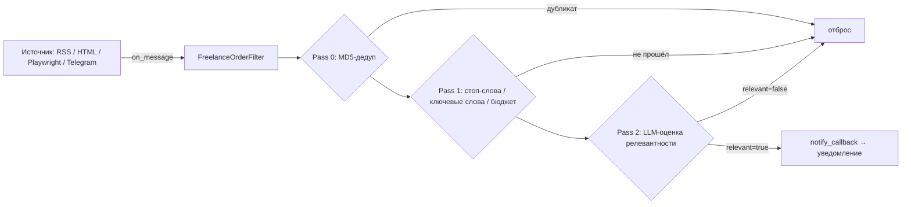

# AI-Core: доменный слой мониторинга фриланс-заказов

Ядро агента для мониторинга фриланс-бирж: собирает заказы из разных источников
(RSS, HTML-каталоги, SPA/JS-биржи через Playwright), отсеивает нерелевантные
трёхпроходным фильтром (дедупликация → стоп-слова/ключевые слова/бюджет →
LLM-оценка релевантности) и отправляет уведомления о подходящих заказах.

> Репозиторий содержит только **доменный слой** — транспорты подключаются через
> общий интерфейс `BaseMessageReceiver`. Готовый сервис (`main.py` с Telegram /
> VK / AmoCRM-адаптерами, `llm_engine`, `freelance_dates`) не входит в этот
> репозиторий и остаётся приватным.

## Возможности

- **Единый интерфейс приёмников** — `BaseMessageReceiver` (ABC): любой транспорт
  (Telethon, VK, AmoCRM, биржи) реализует 4 метода (`start/stop/is_running/validate_chats`)
  и отдаёт сообщения через коллбэк `on_message`.
- **Три веб-ресивера бирж** (`ExchangeRSSReceiver`, `ExchangeHtmlReceiver`,
  `ExchangePlaywrightReceiver`) — реализуют `BaseMessageReceiver` без изменений
  домена:
  - RSS/Atom — на stdlib `xml.etree`, без внешних зависимостей;
  - SSR-HTML — `aiohttp` + `BeautifulSoup`, CSS-селекторы настраиваются в конфиге
    источника;
  - SPA/JS (Kwork, FL.ru и т.п.) — Playwright (Chromium), один браузер
    переиспользуется между циклами, ротация User-Agent против антиботов,
    парсинг через чистые функции (тестируется без браузера).
- **Трёхпроходная фильтрация** `FreelanceOrderFilter`:
  - **Pass 0** — дедупликация по MD5 (in-memory `deque`, опционально Redis-сет
    с TTL, переживает рестарты и работает между процессами);
  - **Pass 1** — стоп-слова → ключевые слова (regex по границам слов) →
    минимальный бюджет (из текста, с учётом валют и диапазонов);
  - **Pass 2** — LLM-оценка релевантности: строгий system-prompt под нишу,
    JSON-ответ (`relevant/budget/tech_stack/task_summary/urgency`), семафор для
    ограничения параллельных запросов, эскалация `max_tokens` для
    reasoning-моделей.
- **Статистика** — счётчики по каждой причине отсева (дубли/стоп-слова/бюджет/
  LLM-отклонения), попадают в сводку уведомлений.
- **Уведомления** — HTML-сообщение о найденном заказе (бюджет, стек, срочность,
  источник, ссылка) через `notify_callback`.
- **Обновление на лету** — список источников и ключевых слов меняется без
  перезапуска сервиса.

## Архитектура

```
ai-core/
├── core/
│   ├── message_monitor.py           # BaseMessageReceiver (ABC) + FreelanceOrderFilter
│   └── freelance_exchange_scraper.py# FreelanceOrder + ресиверы RSS/HTML/Playwright
└── config/
    └── config.json                  # пример конфига источников (публичный)
```

Поток данных:



## Установка зависимостей

```bash
pip install -r requirements.txt
```

Ресиверы используют необязательные зависимости:

| Ресивер                  | Зависимости                                    |
|--------------------------|------------------------------------------------|
| `ExchangeRSSReceiver`    | `aiohttp`                                      |
| `ExchangeHtmlReceiver`   | `aiohttp`, `beautifulsoup4`                    |
| `ExchangePlaywrightReceiver` | `aiohttp`, `playwright` (+ `playwright install chromium`) |

Если зависимость не установлена — ресивер не стартует с предупреждением в логе,
система продолжает работать с остальными.

## Быстрый старт

Это доменный слой, поэтому для запуска нужен «клей»: конфиг-объект с полями
(`dedup_cache_size`, `keywords`, `stopwords`, `keyword_regex`, `min_budget_rub`,
`llm_model`, `llm_temperature`, `llm_max_tokens`, `llm_concurrency`),
`llm_engine` с методом `generate_response(...)` и `notify_callback`.

```python
import asyncio
from core.message_monitor import FreelanceOrderFilter
from core.freelance_exchange_scraper import ExchangeRSSReceiver

async def main():
    sources = [{"url": "https://example.com/feed.rss", "name": "Example", "tags": ["python"]}]

    # 1. Транспорт
    receiver = ExchangeRSSReceiver(sources=sources, interval_sec=600)

    # 2. Фильтр (config / llm_engine / notify_callback — ваша реализация)
    monitor = FreelanceOrderFilter(config=config, llm_engine=llm_engine,
                                   notify_callback=notify)
    monitor.set_receiver(receiver)

    # 3. Запуск
    await monitor.start()
    try:
        await asyncio.sleep(3600)
    finally:
        await monitor.stop()

asyncio.run(main())
```

## Конфигурация источников

Пример источника в `config/config.json`:

```json
{
  "freelance_monitor": {
    "exchange_sources": [
      {
        "name": "Kwork (Python & Telegram)",
        "type": "playwright",
        "url": "https://kwork.ru/projects?c=41&keyword=python",
        "enabled": true,
        "tags": ["python", "telegram", "bot"],
        "selectors": {
          "container": ".want-card.want-card--list",
          "title": ".wants-card__header-title",
          "link": "a[href*='/projects/']",
          "budget": ".wants-card__price"
        }
      }
    ]
  }
}
```

- `type`: `rss` | `html` | `playwright` — какой ресивер использовать.
- `selectors` — только для `html`/`playwright` (см. `DEFAULT_SELECTORS` в
  `ExchangeHtmlReceiver`); поля `deadline`, `author`, `author_link`,
  `responses`, `views`, `published`, `tags` — опциональны.

## Расширение

**Новая биржа без JS** — добавьте источник в конфиг (`type: rss` или `html`)
и при необходимости свои CSS-селекторы.

**Новая биржа с JS (SPA)** — добавьте источник `type: playwright`; дефолтные
селекторы подойдут, если карточки используют типовые классы. Антибот-защита
обходится ротацией UA (`rotate_user_agent: true`) и опциональными параметрами.

**Новый транспорт** (Telegram/VK/AmoCRM) — реализуйте `BaseMessageReceiver`:
`start()`, `stop()`, `is_running`, `validate_chats()` и вызывайте
`on_message(raw_text, source_id, message_link, chat_title, sender_username)`.
Фильтр подхватит его без изменений.

**Redis-дедуп между процессами** — передайте в ресивер/фильтр корутинный
клиент (`redis.asyncio.Redis` с `sadd`/`sismember`/`expire`).

## Совместимость

- Python 3.10+ (используется `X | None` в аннотациях, `match` — нет)
- `asyncio`, типизация `from __future__ import annotations`

## Лицензия

[MIT](LICENSE)
